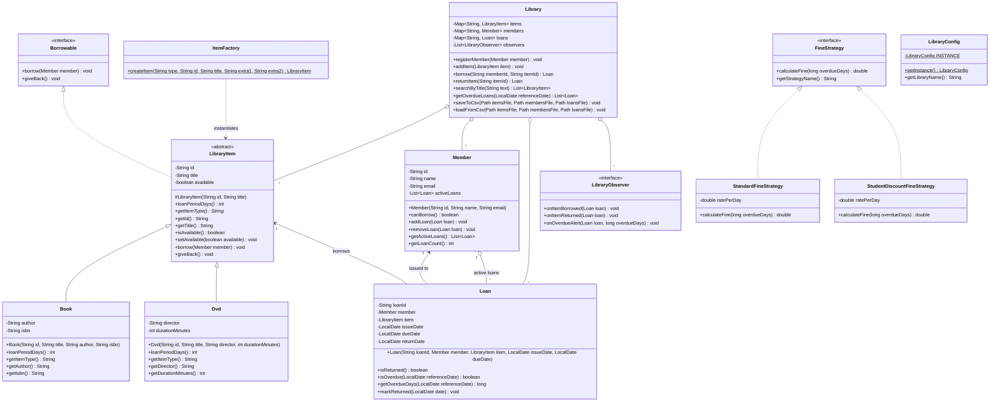
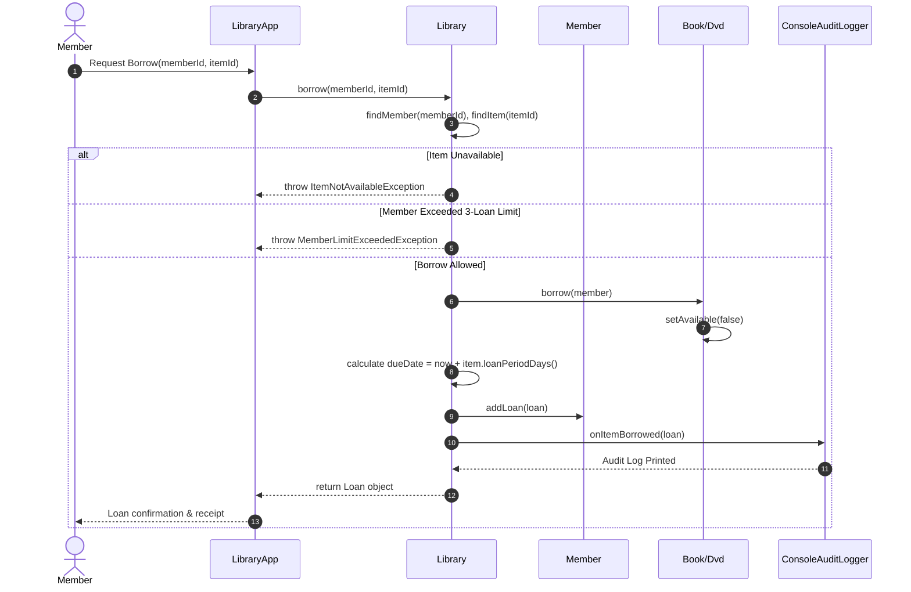

# Mini-Project Report: Library Management System
**Course**: Object-Oriented Programming in Java (Lab 11)  
**Author**: Student Submission  
**Date**: October 2026  

---

## 1. Executive Summary & Project Overview

The **Library Management System** is a modular, production-ready console application built in Java to fulfill the Lab 11 Mini-Project requirements. It consolidates all core Object-Oriented Programming (OOP) principles learned throughout Labs 1 to 10 and integrates modern software engineering practices, including four key design patterns (**Singleton**, **Factory**, **Strategy**, **Observer**), custom exception hierarchies, Java Collections, the Stream API, and robust CSV file persistence across application sessions.

---

## 2. Object-Oriented Design & Principles

### 2.1 Encapsulation
- **Data Protection**: All fields across [`LibraryItem`](file:///c:/Users/user/OneDrive/Documents/Library/OOP%20LABS/Lab%2011/LibraryItem.java), [`Book`](file:///c:/Users/user/OneDrive/Documents/Library/OOP%20LABS/Lab%2011/Book.java), [`Dvd`](file:///c:/Users/user/OneDrive/Documents/Library/OOP%20LABS/Lab%2011/Dvd.java), [`Member`](file:///c:/Users/user/OneDrive/Documents/Library/OOP%20LABS/Lab%2011/Member.java), and [`Loan`](file:///c:/Users/user/OneDrive/Documents/Library/OOP%20LABS/Lab%2011/Loan.java) are declared `private` or `final`.
- **Validation**: Constructors and setter methods enforce defensive invariants (e.g. non-null, non-blank strings, positive DVD durations, valid email strings containing `'@'`).
- **Encapsulated Collections**: Patron active loans are exposed via `Collections.unmodifiableList()`, preventing external mutation of internal list states.

### 2.2 Inheritance & Abstraction
- **Abstract Superclass [`LibraryItem`](file:///c:/Users/user/OneDrive/Documents/Library/OOP%20LABS/Lab%2011/LibraryItem.java)**: Defines common state (`id`, `title`, `available`) and behavioural signatures shared by all catalogued items.
- **Abstract Method `loanPeriodDays()`**: Forces concrete subclasses to specify their distinct borrowing periods.
- **Subclasses [`Book`](file:///c:/Users/user/OneDrive/Documents/Library/OOP%20LABS/Lab%2011/Book.java) & [`Dvd`](file:///c:/Users/user/OneDrive/Documents/Library/OOP%20LABS/Lab%2011/Dvd.java)**:
  - `Book` extends `LibraryItem` adding `author` and `isbn`, defining a 14-day borrowing window.
  - `Dvd` extends `LibraryItem` adding `director` and `durationMinutes`, defining a 7-day borrowing window.

### 2.3 Polymorphism & Interfaces
- **[`Borrowable`](file:///c:/Users/user/OneDrive/Documents/Library/OOP%20LABS/Lab%2011/Borrowable.java) Interface**: Exposes `borrow(Member)` and `giveBack()` contracts.
- **Polymorphic Dispatch**: Calling `loanPeriodDays()` on a `LibraryItem` reference executes the specialized calculation appropriate for that item type without `instanceof` conditionals.

---

## 3. Design Patterns Applied

| Pattern | Class / Interface | Role & Architectural Purpose |
| :--- | :--- | :--- |
| **Singleton** | [`LibraryConfig`](file:///c:/Users/user/OneDrive/Documents/Library/OOP%20LABS/Lab%2011/LibraryConfig.java) | Provides a single, global point of access to system configuration (library title, fine rates, max patron loan limit). |
| **Factory** | [`ItemFactory`](file:///c:/Users/user/OneDrive/Documents/Library/OOP%20LABS/Lab%2011/ItemFactory.java) | Decouples caller code and CSV deserialization logic from concrete `Book` and `Dvd` constructors using standard parameters. |
| **Strategy** | [`FineStrategy`](file:///c:/Users/user/OneDrive/Documents/Library/OOP%20LABS/Lab%2011/FineStrategy.java) | Encapsulates overdue fee algorithms (`StandardFineStrategy`, `StudentDiscountFineStrategy`, `VipWaiverFineStrategy`), allowing runtime swapping. |
| **Observer** | [`LibraryObserver`](file:///c:/Users/user/OneDrive/Documents/Library/OOP%20LABS/Lab%2011/LibraryObserver.java) | Publishes real-time events (`onItemBorrowed`, `onItemReturned`, `onOverdueAlert`) to subscribed observers such as `ConsoleAuditLogger`. |

---

## 4. Custom Exceptions & Robust Error Handling

Two checked exception classes provide domain-specific error handling:
1. **[`ItemNotAvailableException`](file:///c:/Users/user/OneDrive/Documents/Library/OOP%20LABS/Lab%2011/ItemNotAvailableException.java)**: Thrown when attempting to borrow an item that is currently checked out by another patron.
2. **[`MemberLimitExceededException`](file:///c:/Users/user/OneDrive/Documents/Library/OOP%20LABS/Lab%2011/MemberLimitExceededException.java)**: Thrown when a patron attempts to borrow more than the permitted threshold of 3 active loans.

---

## 5. Collections & Stream API

- **Fast Lookups**: `Map<String, LibraryItem>`, `Map<String, Member>`, and `Map<String, Loan>` indexed by unique string identifiers ensure O(1) retrieval.
- **Title Search Query**:
  ```java
  public List<LibraryItem> searchByTitle(String text) {
      return items.values().stream()
          .filter(i -> i.getTitle().toLowerCase().contains(text.trim().toLowerCase()))
          .sorted(Comparator.comparing(LibraryItem::getTitle))
          .toList();
  }
  ```
- **Overdue Loans Detection**:
  ```java
  public List<Loan> getOverdueLoans(LocalDate ref) {
      return loans.values().stream()
          .filter(l -> l.isOverdue(ref))
          .sorted(Comparator.comparing(Loan::getDueDate))
          .toList();
  }
  ```

---

## 6. File Persistence (CSV Database)

The application automatically saves and reloads state from three flat CSV files:
1. `items.csv`: `TYPE,ID,TITLE,AVAILABLE,EXTRA1,EXTRA2`
2. `members.csv`: `ID,NAME,EMAIL`
3. `loans.csv`: `LOAN_ID,MEMBER_ID,ITEM_ID,ISSUE_DATE,DUE_DATE,RETURN_DATE`

On startup, [`LibraryApp`](file:///c:/Users/user/OneDrive/Documents/Library/OOP%20LABS/Lab%2011/LibraryApp.java) rehydrates the entire object graph, reconnecting active loans to patrons and marking borrowed items unavailable. If files do not exist, a realistic initial catalogue is automatically seeded.

---

## 7. UML Class Diagram



---

## 8. Sequence Diagram: Borrowing an Item



---

## 9. Compilation & Execution Instructions

### Compilation
Open a terminal in the Lab 11 directory and compile all source files:
```bash
javac *.java
```

### Running the Demonstration Programs
1. **Program 11.1 (Singleton & Factory Demo)**:
   ```bash
   java SingletonFactoryDemo
   ```
2. **Program 11.2 (Strategy & Observer Demo)**:
   ```bash
   java StrategyObserverDemo
   ```

### Running the Mini-Project
1. **Automated End-to-End Test Suite**:
   ```bash
   java -ea LibraryApp --demo
   ```
2. **Interactive Console Application**:
   ```bash
   java LibraryApp
   ```
